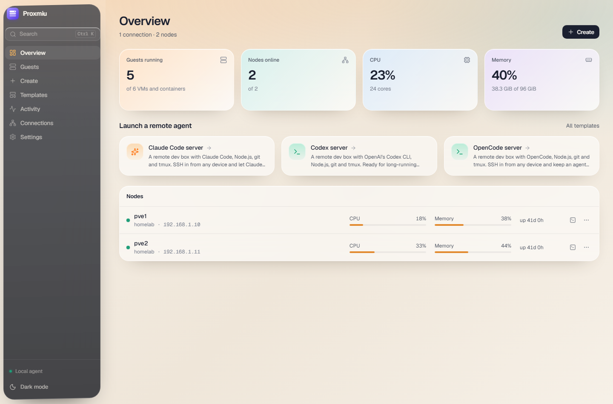
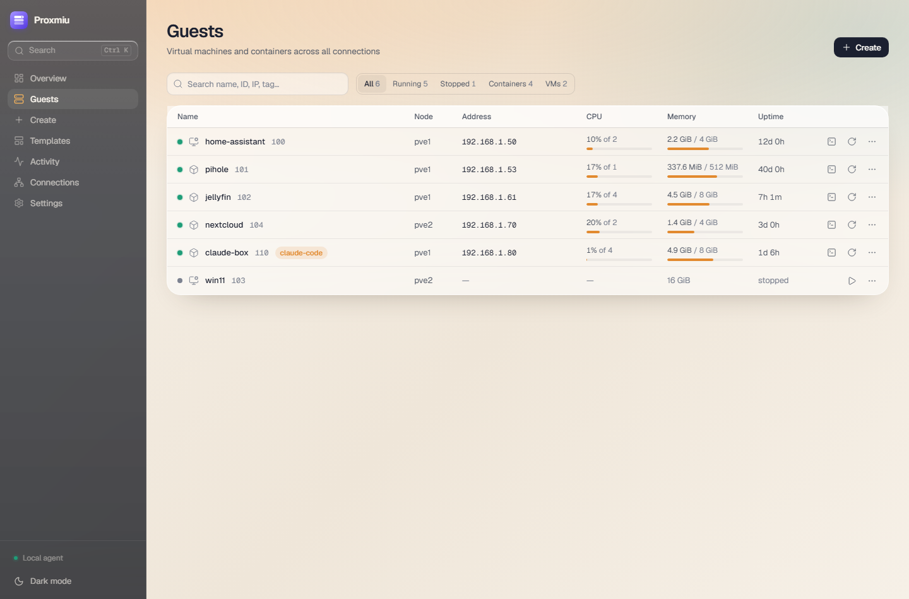
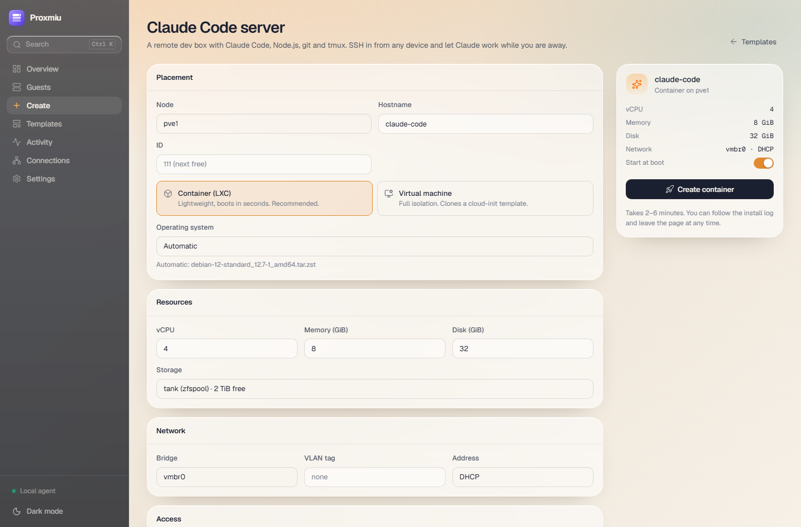
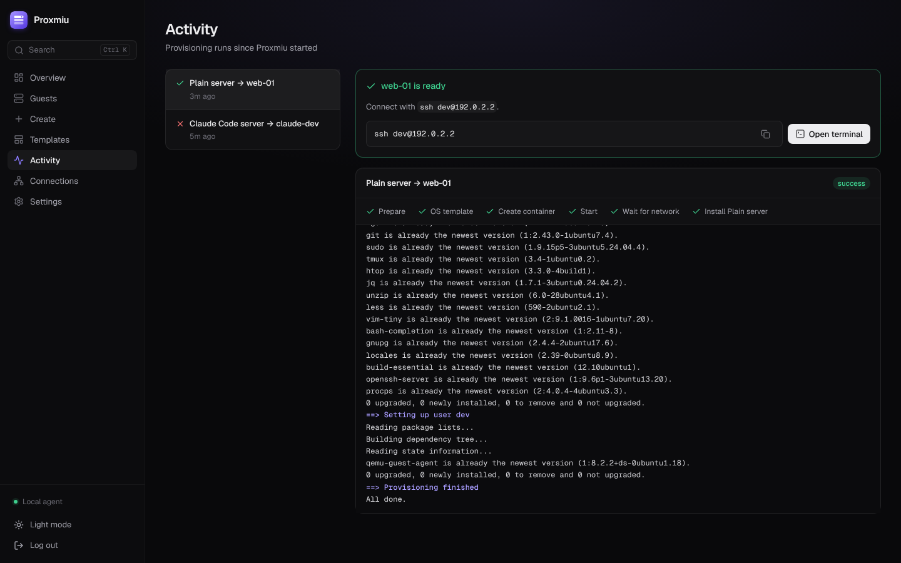
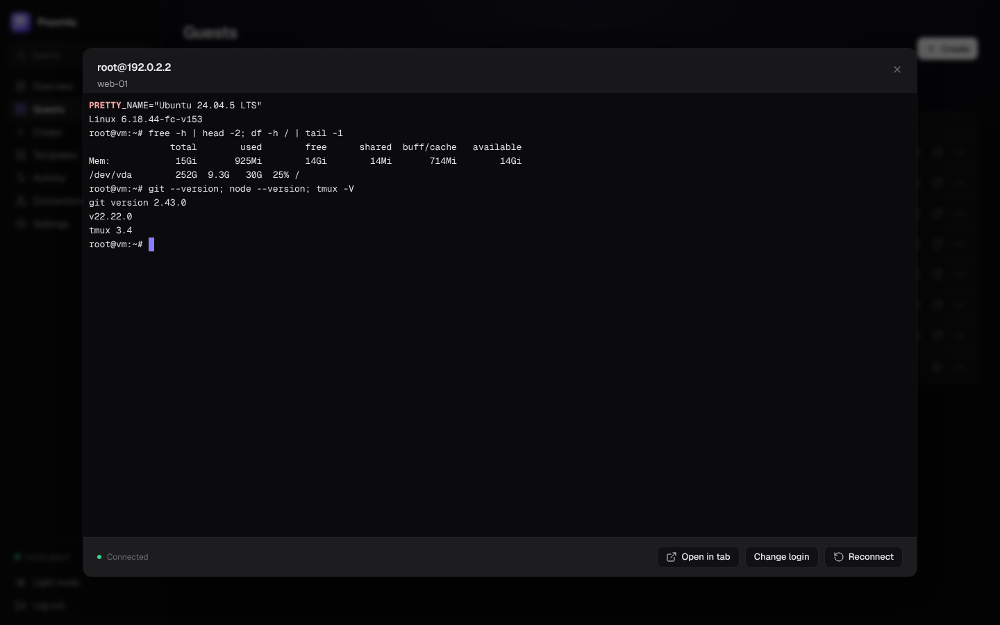
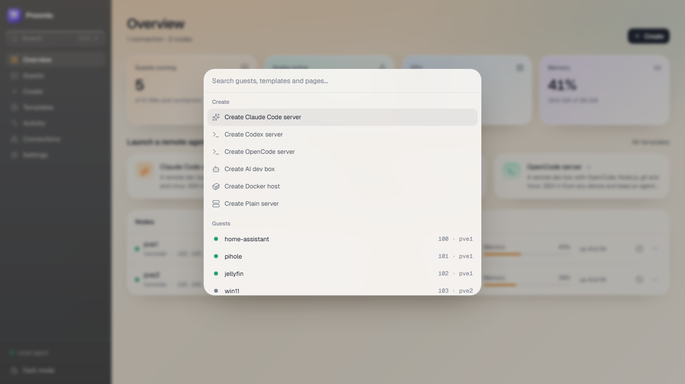
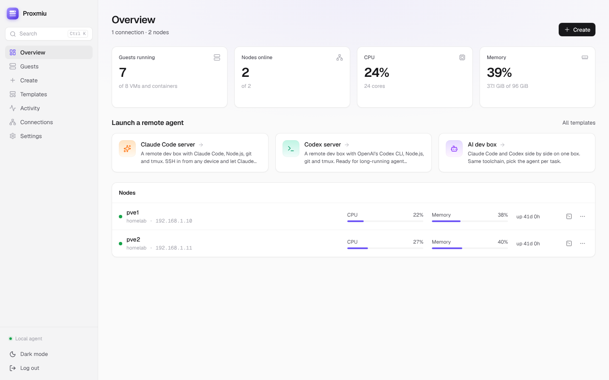
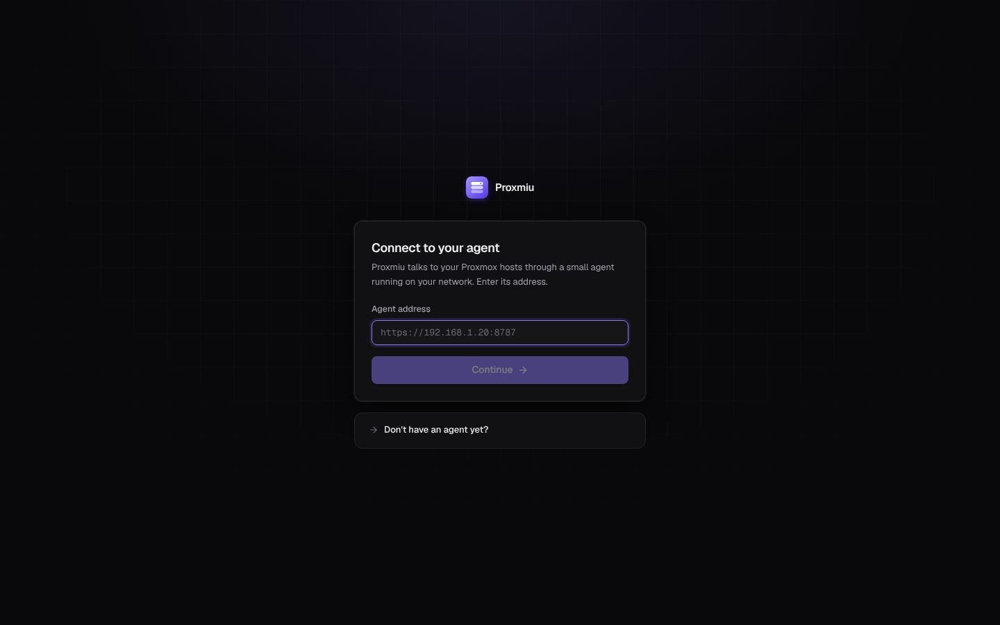
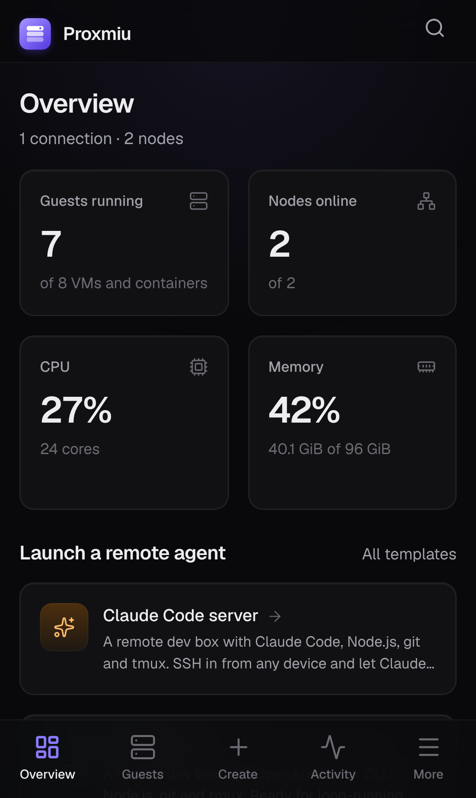
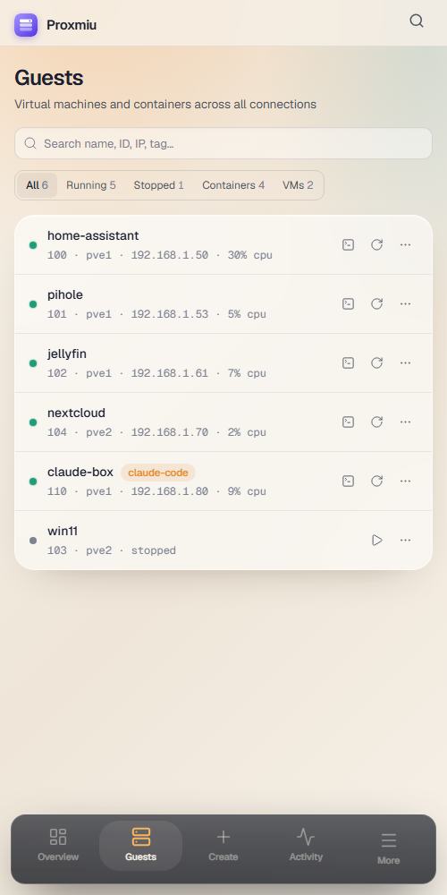

# Proxmiu

A modern web app for managing Proxmox VE on your local network: find hosts, start/stop/reboot guests, open SSH terminals in the browser, and spin up ready-to-use servers from templates, including remote **Claude Code**, **Codex** and **OpenCode** boxes.

[](https://github.com/LasseSLambertsen/proxmiu/actions/workflows/ci.yml)
[](LICENSE)



<table>
  <tr>
    <td width="50%"><br /><sub><b>Guests</b>: live status, addresses and usage, with one-click SSH, reboot and more</sub></td>
    <td width="50%"><br /><sub><b>Create</b>: a Claude Code server from a template, with every setting adjustable</sub></td>
  </tr>
  <tr>
    <td><br /><sub><b>Activity</b>: each step and the full install log, live</sub></td>
    <td><br /><sub><b>Terminal</b>: SSH into any guest or node from the browser</sub></td>
  </tr>
  <tr>
    <td><br /><sub><b>⌘K</b>: jump to any guest, template or page</sub></td>
    <td><br /><sub><b>Light mode</b></sub></td>
  </tr>
  <tr>
    <td><br /><sub><b>Hosted UI</b>: connect a Vercel/Netlify deployment to your agent</sub></td>
    <td align="center">
      
      <br /><sub><b>On iPhone</b>: bottom tabs, installable to the home screen</sub>
    </td>
  </tr>
</table>

<sub>Screenshots use the bundled mock Proxmox API (<code>npm run mock</code>).</sub>

## How it fits together

```
 browser ──► Proxmiu UI ──────────────► Proxmiu agent ──► Proxmox API (:8006)
             (Vercel, Netlify,          (on your LAN)  └─► SSH to guests and nodes
              or served by the agent)
```

The **UI** is a static single-page app. Host it on Vercel or Netlify, or let the agent serve it.

The **agent** is a small Node service that runs on your network (Docker, or any machine with Node 20+). It talks to Proxmox, scans the LAN, opens SSH sessions and runs provisioning. Cloud hosts can't reach your LAN, so this part always runs at home. The UI only ever talks to the agent, straight from your browser.

## Features

- **Discovery** – scans the subnets the agent is on for Proxmox (port 8006) and connects with an API token or password.
- **Overview** – nodes, VMs and containers across all connections with live CPU, memory, IP addresses and uptime.
- **Power actions** – start, shut down, reboot, force stop and delete guests; reboot or shut down nodes.
- **SSH in the browser** – full terminal to any guest or node.
- **Templates** – one-click LXC containers (or VMs cloned from a cloud-init template), provisioned over SSH with a live log:
  - **Claude Code server**, **Codex server**, **OpenCode server**, **AI dev box** (all three), **Docker host**, **Plain server**
  - Optional: persistent tmux sessions, GitHub CLI + token, clone a repo, git identity, Tailscale
- **Custom templates** – duplicate a built-in or write your own bash script with typed options, or point a template at a script in a GitHub repository.
- **Command palette** – <kbd>⌘K</kbd> / <kbd>Ctrl K</kbd> to jump to any guest, page or template.
- **Community Scripts** - browse [community-scripts.org](https://community-scripts.org) and turn any container app into a template; the installer runs inside the guest.

## 1. Run the agent

### On your Proxmox host (recommended)

Open a shell on the Proxmox host (in the web UI: select the node → **Shell**, or SSH in as root) and run:

```bash
bash -c "$(curl -fsSL https://raw.githubusercontent.com/LasseSLambertsen/proxmiu/main/scripts/proxmox-install.sh)"
```

> **While the repository is private**, give the script a GitHub token with read access to it:
>
> ```bash
> export GITHUB_TOKEN=github_pat_...
> bash -c "$(curl -fsSL -H "Authorization: Bearer $GITHUB_TOKEN" https://raw.githubusercontent.com/LasseSLambertsen/proxmiu/main/scripts/proxmox-install.sh)"
> ```

In about three minutes you get the address and password. The script:

1. Downloads the latest Debian 12 container template, if the host doesn't have it.
2. Creates an unprivileged container (`proxmiu`, 2 cores, 1 GiB RAM, 8 GiB disk, DHCP on `vmbr0`). It is set to **start at boot** and tagged `proxmiu`.
3. Installs Node.js and the agent inside it as a **systemd service** that restarts on failure, with a generated password.
4. Creates a Proxmox user `proxmiu@pve` with a **limited `Proxmiu` role** (inventory, power actions, creating and deleting guests, template downloads, node reboot; no user, storage or cluster administration) and an API token `proxmiu@pve!agent-<CTID>`, then **adds this host to the agent**, so it shows up immediately.
5. Asks whether to trust the agent's SSH key for root on this host, so you can open terminals to the node from the browser. On a cluster this applies to every node.

The agent runs in its own container, so nothing is installed on the Proxmox host itself.

**Options:** set any of these in front of the command.

| Variable | Default | |
|---|---|---|
| `CTID` | next free ID | Container ID |
| `CT_HOSTNAME` | `proxmiu` | |
| `STORAGE` | first active container storage | e.g. `local-lvm`, `local-zfs` |
| `BRIDGE` | `vmbr0` | |
| `IP` / `GW` | DHCP | Static address, e.g. `IP=192.168.1.40/24 GW=192.168.1.1` |
| `CORES` / `MEMORY` / `DISK` | `2` / `1024` / `8` | MiB for memory, GiB for disk |
| `PROXMIU_PASSWORD` | generated | |
| `PROXMIU_ALLOWED_ORIGINS` | – | Your hosted UI, e.g. `https://proxmiu.vercel.app` |
| `PROXMIU_TLS` | `0` | `1` to serve HTTPS (needed for a hosted UI, see below) |
| `CONNECT_HOST` | `1` | `0` to skip creating the API token and adding this host |
| `FULL_ACCESS` | `0` | `1` to use a `root@pam` token instead of the limited `proxmiu@pve` user |
| `ADD_SSH_KEY` | ask | `1` or `0` to answer the SSH key question up front |

For example, a static IP with the hosted UI enabled:

```bash
IP=192.168.1.40/24 GW=192.168.1.1 PROXMIU_TLS=1 PROXMIU_ALLOWED_ORIGINS=https://proxmiu.vercel.app \
  bash -c "$(curl -fsSL https://raw.githubusercontent.com/LasseSLambertsen/proxmiu/main/scripts/proxmox-install.sh)"
```

**Day to day** (from the Proxmox host shell, with your container ID):

```bash
pct exec <CTID> -- /opt/proxmiu/scripts/install.sh           # update to the latest version
pct exec <CTID> -- journalctl -u proxmiu -f                  # follow the logs
pct exec <CTID> -- nano /etc/proxmiu/proxmiu.env             # change password, origins, TLS…
pct exec <CTID> -- systemctl restart proxmiu                 # …then restart
```

While the repo is private, prefix the update with `env GITHUB_TOKEN=...`, e.g. `pct exec <CTID> -- env GITHUB_TOKEN=... /opt/proxmiu/scripts/install.sh`. Updates keep your password, settings, connections and SSH key.

**Uninstall:**

```bash
pct stop <CTID> && pct destroy <CTID>
pveum user token remove proxmiu@pve agent-<CTID>
# if no other agent uses them: pveum user delete proxmiu@pve && pveum role delete Proxmiu
# and delete the "proxmiu" line from /root/.ssh/authorized_keys if you added the key
```

### On any Debian or Ubuntu machine

The same installer works on any always-on Debian/Ubuntu box or VM with systemd. Run as root:

```bash
curl -fsSL https://raw.githubusercontent.com/LasseSLambertsen/proxmiu/main/scripts/install.sh | bash
```

It installs to `/opt/proxmiu`, stores data in `/var/lib/proxmiu` and settings in `/etc/proxmiu/proxmiu.env`, and enables the `proxmiu` service at boot. Run it again to update. It accepts the same `PROXMIU_*` and `GITHUB_TOKEN` variables. Afterwards, add your Proxmox host under **Connections**.

### With Docker

```bash
git clone https://github.com/LasseSLambertsen/proxmiu.git && cd proxmiu
cp .env.example .env        # set PROXMIU_PASSWORD
docker compose up -d --build
```

`restart: unless-stopped` brings it back after reboots.

Whichever way you install, open `http://<agent-address>:8787`. The agent serves the UI itself, so this is all you need for a self-hosted setup.

## 2. (Optional) Host the UI on Vercel or Netlify

The repo includes `vercel.json` and `netlify.toml`. Import it in either dashboard, with no settings to change. The build runs `npm run build:web` and publishes `dist/web`.

Then allow that site to use your agent, and serve the agent over HTTPS. Browsers block `http://` requests from an `https://` page unless the target is `localhost`.

```bash
# .env on the agent machine
PROXMIU_PASSWORD=something-long
PROXMIU_ALLOWED_ORIGINS=https://your-proxmiu.vercel.app
PROXMIU_TLS=1
```

Restart the agent, open the hosted site, and enter `https://<agent-machine>:8787`.

With `PROXMIU_TLS=1` the agent generates a self-signed certificate. Visit `https://<agent-machine>:8787` once and accept it, then connect from the hosted UI. To avoid the warning, pass your own certificate with `PROXMIU_TLS_CERT` and `PROXMIU_TLS_KEY`, or put the agent behind Tailscale or a reverse proxy with a real certificate.

### Browser support for hosted UIs

| Browser | `http://` agent on a LAN IP | Notes |
|---|---|---|
| Chrome / Edge desktop (142+) | Works | Chrome asks to allow access to local network devices. The terminal may still need an `https://` agent. |
| Safari, and every browser on iOS | Blocked | WebKit hasn't shipped Local Network Access yet. Use an `https://` agent with a trusted certificate. |
| Firefox | Blocked | Use an `https://` agent. |

No browser lets a web page *discover* devices on your network. Scanning always happens in the agent.

### iPhone and iPad

iOS needs the agent on HTTPS with a trusted certificate. The easiest way is [Tailscale](https://tailscale.com), which also works away from home:

```bash
# on the agent machine, with Tailscale installed and HTTPS enabled for your tailnet
tailscale serve --bg 8787
```

With the Tailscale app on, connect to `https://<machine>.<tailnet>.ts.net`. To install Proxmiu as an app, use Safari's Share → Add to Home Screen.

## 3. Connect Proxmox

The Proxmox installer does this for you. To add a host by hand, create a limited user and token in a shell on that host:

```bash
pveum role add Proxmiu --privs "Sys.Audit,Sys.PowerMgmt,VM.Audit,VM.PowerMgmt,VM.Allocate,VM.Clone,VM.Config.CPU,VM.Config.Memory,VM.Config.Disk,VM.Config.Network,VM.Config.Options,VM.Config.Cloudinit,VM.Config.HWType,Datastore.Audit,Datastore.AllocateSpace,Datastore.AllocateTemplate,SDN.Audit,SDN.Use,VM.GuestAgent.Audit"
pveum user add proxmiu@pve
pveum acl modify / --users proxmiu@pve --roles Proxmiu
pveum user token add proxmiu@pve agent --privsep 0
```

On Proxmox VE 8, replace `VM.GuestAgent.Audit` with `VM.Monitor`. Then go to **Connections → Scan → Connect** in Proxmiu, with token ID `proxmiu@pve!agent` and the secret printed above.

For the quickest test setup, `pveum user token add root@pam proxmiu --privsep 0` also works, but that token has full root access.

## How creating a server works

1. Picks the next free VMID, and downloads the Debian/Ubuntu container template if the node does not have it.
2. Creates an unprivileged container (nesting on for dev templates) with the agent's SSH key and your own keys, then starts it.
3. Waits for an IP: container interfaces, the QEMU guest agent, or the agent's ARP table for VMs without one.
4. SSHes in and runs the template: base setup (updates, a `dev` sudo user, your keys), the template script, then the optional extras.

When it's done you get `ssh dev@<ip>` and a button to open a terminal. For the AI templates, run `claude`, `codex` or `opencode`. Without an API key, you sign in on first run.

**VMs** need an existing cloud-init VM template on the node (see [Cloud-Init Support](https://pve.proxmox.com/wiki/Cloud-Init_Support)).

## Agent configuration

| Variable | Default | |
|---|---|---|
| `PROXMIU_PASSWORD` | – | Required unless listening on localhost only |
| `PROXMIU_ALLOWED_ORIGINS` | – | Comma-separated origins of hosted UIs allowed to use the agent |
| `PROXMIU_TLS` | – | `1` to serve HTTPS with a generated self-signed certificate |
| `PROXMIU_TLS_CERT` / `PROXMIU_TLS_KEY` | – | Paths to your own certificate and key |
| `HOST` | `127.0.0.1`, or `0.0.0.0` with a password | |
| `PORT` | `8787` | |
| `PROXMIU_DATA_DIR` | `./data` | State, encrypted credentials, SSH key, TLS certificate |
| `PROXMIU_SECRET_KEY` | generated | 32-byte base64 key for encrypting credentials and signing sessions |

## Security

The agent holds credentials that control your whole Proxmox setup.

- **Password:** it refuses to listen beyond localhost without `PROXMIU_PASSWORD`. Hosted UIs are only allowed when a password is set.
- **Sessions:** signed bearer tokens that expire after 30 days. Changing `PROXMIU_SECRET_KEY` signs everyone out.
- **Cross-site requests:** requests from origins not in `PROXMIU_ALLOWED_ORIGINS` are rejected, WebSockets included. Without a password, only loopback `Host` headers are accepted, which blocks DNS rebinding.
- **Credentials at rest:** encrypted with AES-256-GCM.
- **Host keys:** SSH host keys of guests are not pinned, since guests are created and rebuilt often.

See [SECURITY.md](SECURITY.md) for the full policy and private reporting link.

## License

[MIT](LICENSE)

## Development

```bash
npm install
npm run mock       # fake Proxmox API on https://127.0.0.1:8006 (token root@pam!proxmiu, secret "mock")
npm run dev        # agent on :8787, Vite on :5173 with hot reload
npm run typecheck
npm test
npm run build
```

Stack: Fastify, ssh2 and undici for the agent; React, TanStack Query, Tailwind CSS v4, Radix and cmdk for the UI, set in Geist.

Contributions are welcome. Read [CONTRIBUTING.md](CONTRIBUTING.md) for the setup, architecture rules and pull-request checklist.
